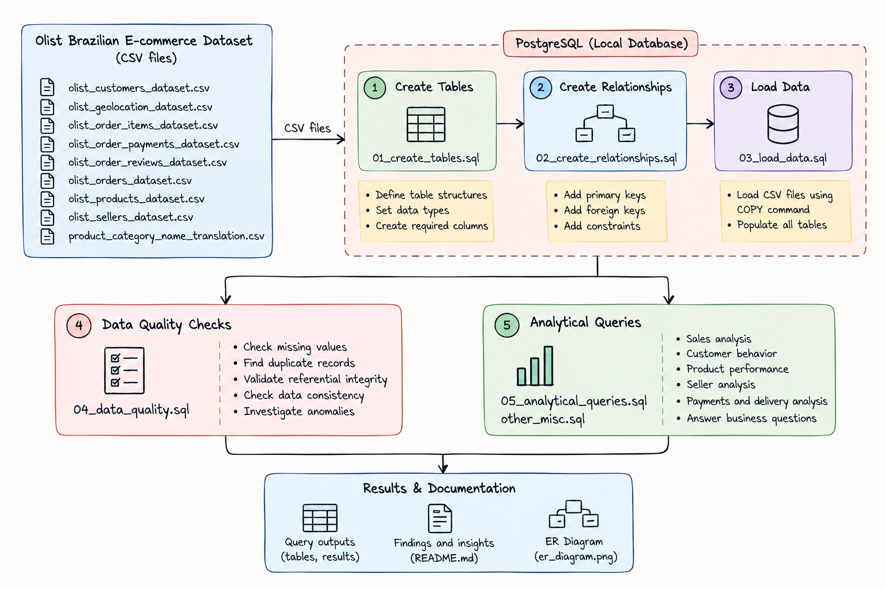
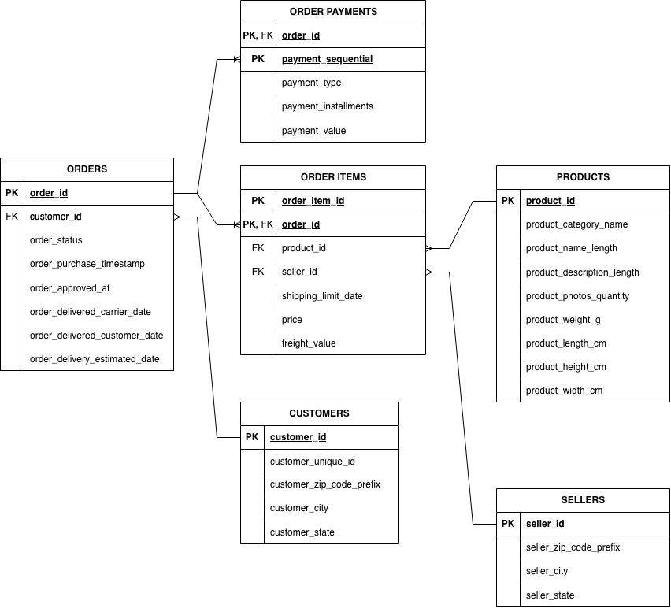

# Olist E-commerce Sales Analysis

> A SQL-based analytics project that explores Brazilian e-commerce
> orders, customers, products, sellers, payments, and delivery
> performance using the Olist public dataset.

## Overview
This project analyzes the Olist Brazilian E-Commerce dataset to answer practical business questions using PostgreSQL. It transforms related CSV files into a relational data model, applies data-quality checks, and uses SQL aggregations, window functions, subqueries, temporary tables and much more to investigate sales, customer purchasing behavior, product categories, seller performance, payment methods, and delivery timeliness. The final output is a set of reusable SQL analyses and documented data-quality findings.

## Objectives
- [x] Load and model the core Olist CSV datasets in a relational database.
- [x] Write SQL queries to analyze sales, orders, products, customers, sellers, payments, and delivery performance.
- [x] Create data-quality checks and investigate findings against the source data.
## Architecture




End-to-end workflow:
1. **Source data:** Obtain the Olist CSV files from the public dataset.
2. **Relational storage:** Load the CSV data into PostgreSQL tables.
3. **Data model:** Connect customers, orders, order items, products, sellers, and payments using primary and foreign keys.
4. **Data quality:** Run checks for uniqueness, missing values, referential integrity, valid values, timestamp consistency, and financial reconciliation.
5. **Analysis:** Use SQL joins, aggregations, subqueries, CTEs, and window functions to answer business questions.

## Tech Stack
Technology Purpose
------------ ------------------------------------------------------------

PostgreSQL Relational storage and SQL execution, SQL Data aggregation, transformation, validation, and analysis
CSV Source data format, Git Version control and project collaboration project work 

## Dataset
- **Source:** [Olist Brazilian E-Commerce Public Dataset on Kaggle](https://www.kaggle.com/datasets/olistbr/brazilian-ecommerce)
- **Format:** CSV
- **Description:** An Brazilian e-commerce dataset containing orders, customers, order items, products, sellers, payments, and related information. The project focuses on the core tables used for sales and operational analysis.
- **Core tables:** `customers`, `orders`, `order_items`, `products`, `sellers`, and `order_payments`.

>Already have the dataset inside the repo, Check here: `dataset/`.

## Data Quality
The project includes data-quality checks intended to assess:
- **Uniqueness:** Duplicate primary-key values, including composite keys such as `(order_id, order_item_id)` and `(order_id, payment_sequential)`.
- **Completeness:** Missing values in important identifiers, timestamps, and descriptive fields.
- **Referential integrity:** Order items referencing orders, products, or sellers; and payments referencing  orders.
- **Validity:** Unexpected values such as invalid prices, payment amounts, dimensions, or installments.
- **Timestamp consistency:** Delivery and purchase dates that conflict with expected order lifecycle rules.
- **Financial reconciliation:** Comparing order-level item-price and freight totals with order-level payment totals.

>A reconciliation query identified **576 orders with differences** between item-plus-freight totals and recorded payment totals. Selected records were manually checked against the source CSVs, and the SQL calculations matched the source data. The causes of the differences have not yet been established, so they are treated as investigation findings rather than automatically classified as errors.

## Data Model
The project uses the original Olist entity structure rather than redesigning the source model.

- **Customers:** `customer_id` identifies the customer record associated with an order; `customer_unique_id` can link records belonging to the same underlying customer across orders.
- **Orders:** One row per `order_id`, linked to `customers` through `customer_id`.
- **Order items:** One row per item within an order. The composite primary key is `(order_id, order_item_id)`. Each row references an order, product, and seller.
- **Products:** One row per `product_id`, containing product attributes and category.
- **Sellers:** One row per `seller_id`, containing seller location attributes.
- **Order payments:** Payment records associated with orders. The composite key is `(order_id, payment_sequential)`.

## Getting Started
### Prerequisites
- PostgreSQL (a recent supported version)
- A PostgreSQL client, such as `psql` or pgAdmin
- Git
- The Olist CSV dataset downloaded from Kaggle

### Installation
1. **Clone your repository:**

``` bash
git clone https://github.com/ashwinam/brazzilian-ecomm-analytics.git

cd brazzilian-ecomm-analytics
```

2. **Install the vs code extensions for easy of writting queries rather than copy paste here and there:**
	1. Install the extensions
		1. sql tools: https://marketplace.visualstudio.com/items?itemName=mtxr.sqltools
		2. sqltools/connectors for postgresql: https://marketplace.visualstudio.com/items?itemName=mtxr.sqltools-driver-pg
		3. mysql connector: https://marketplace.visualstudio.com/items?itemName=mtxr.sqltools-driver-mysql
### Run the Project
Run the SQL scripts in the order required by your repository. A typical sequence is:

1. Create and tables.
2. Import the source CSV files.
3. Run data-quality checks.
4. Run the analysis queries.

>**For all those there is a folder called `sql/`, Go inside and see which thing you want.**

## Results
The project explores questions such as:
- What are monthly merchandise sales and how do they change over time?
- What is the average merchandise order value under a documented definition?
- Which product categories generate the most item sales?
- Which products have the highest total item sales?
- How many distinct customers place repeat orders?
- What is the average time between purchases for repeat customers?
- What is the distribution of recorded payment methods?
- What percentage of delivered orders arrived later than estimated?
- Which sellers have the highest distinct-order volume and item sales?
## Challenges and Design Decisions
>**Commented inside the analytical file for issues and approaches:**
- **Customer identity:** `customer_unique_id` is used for repeat-customer analysis because `customer_id` represents the customer record associated with an order.
- **Sales definition:** Merchandise sales use `order_items.price` freight is excluded unless explicitly stated.
- **Sales trends with missing months:** `LAG()` compares rows that exist in its input. To compare consecutive calendar months, a continuous calendar of months may be needed, with missing-month handling documented.
- **Payment reconciliation:** Item-plus-freight totals that differ from recorded payment totals are investigated rather than automatically treated as errors.
- **Order counts:** Distinct `order_id` values are used when counting orders from the order-item table.

## References
- [Olist Brazilian E-Commerce Public Dataset](https://www.kaggle.com/datasets/olistbr/brazilian-ecommerce)
- [PostgreSQL Documentation](https://www.postgresql.org/docs/)
- [PostgreSQL Window Functions](https://www.postgresql.org/docs/current/functions-window.html)